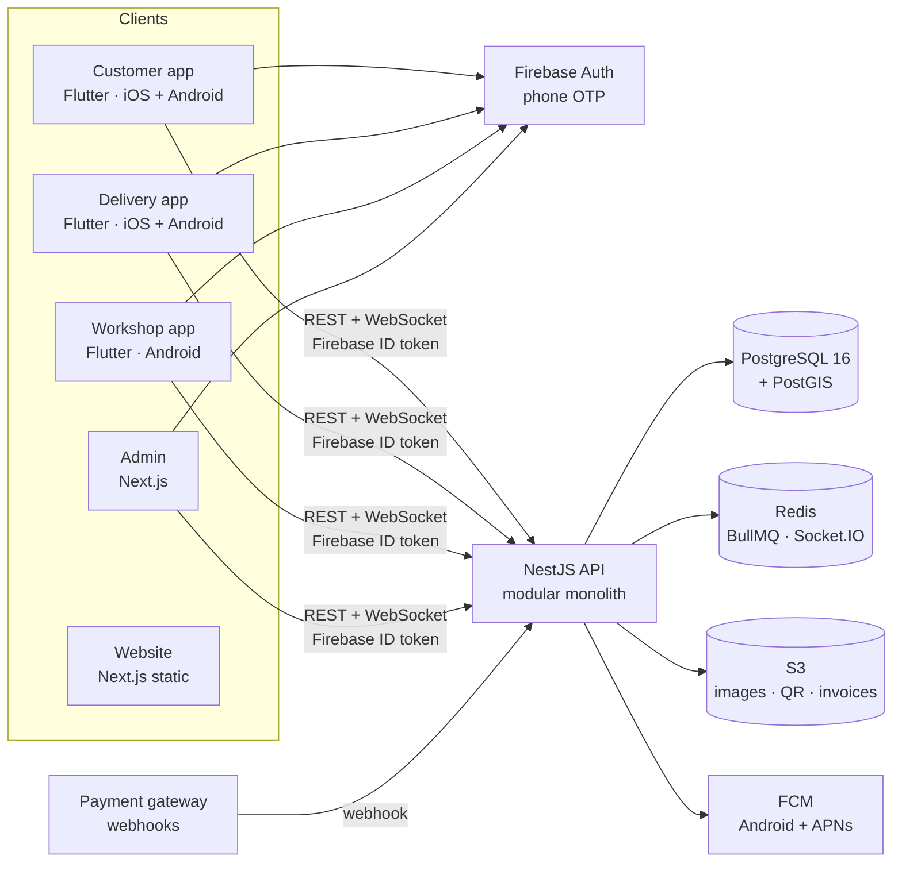
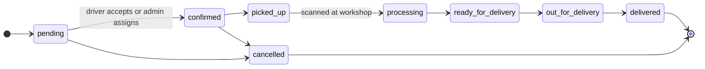
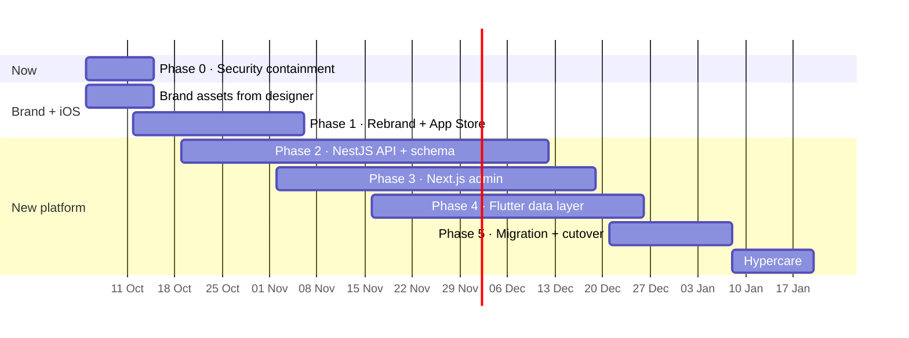

# Cloud Ironing Platform Audit
Source: https://claude.ai/artifact/HCKqpD4KJjd4w6iqYwGT7m · Last updated: 2026-10-02 · Archived 2026-11-23

> Mermaid diagrams are kept as mermaid code blocks. The original page marked this report Confidential (section 02 describes unpatched security holes).

Technical audit · 2 October 2026 · repo laundry @ 2e7debd

## Cloud Ironing platform audit

A full review of the five Flutter apps, Cloud Functions and Firestore rules, plus the plan for the four changes you asked for: rebrand, App Store launch, a Next.js admin, and a move from Firestore to PostgreSQL.

**Confidential.** Section 02 describes unpatched holes in a live system. Share it only with the people fixing them until Phase 0 is deployed.

**5** Flutter apps

**~102K** lines of Dart

**663** Firestore call sites

**51** realtime listeners

**~200** lines of tests

**1,255** `print()` calls

Agreed so far

### Decisions already made

Backend NestJS + Prisma + PostgreSQL

Play Store Keep package IDs, update listings in place

App Store Customer app + delivery partner app

Brand name Shortlist in this report

01

### Verdict

The product works and is live, but the database is open to the internet. Under the Firestore rules in the repo, anyone holding the app's public Firebase config can read every customer's name, phone and home address, read every delivery partner's login code and Aadhaar number, and edit or delete any order. A signed-in customer can promote themselves to admin. These problems exist in production today if those rules are deployed, and the Postgres migration will take about four months, so a one-to-two-week containment phase comes first.

The Flutter apps are a reasonable base to rebrand and take to iOS. The backend is not worth keeping: business rules such as pricing, order numbering, assignment and notifications run on the phones and in the admin browser, with nothing on a server enforcing them. That is the real argument for the migration. At about 69 installs, Firebase cost is not.

| Area | Rating | Why |
|---|---|---|
| Security | Critical | Orders world-writable; customer PII, driver login codes and Aadhaar world-readable; any customer can self-create an admin record; driver login is checked on the device. |
| Data integrity | Poor | The order-number fallback can overwrite another order. There are three numbering schemes (`CI`, `CL`, `A`), two address shapes, driver IDs in three fields, and order status is free text with no state machine. |
| Dispatch | Fair | The 3-driver broadcast works on the happy path. Two paths leave orders stuck in "Searching" forever, and drivers drop out of auto-dispatch after their first accepted order. |
| Admin panel | Fair | 8 working tabs. About 10 screens are unreachable, there is no role gating, the dashboard reads whole collections, and image upload uses `File`, which fails on web. |
| Code health | Fair | 7 admin files over 1,000 lines, order assignment copied in 4 places, 1,255 debug prints, and no crash reporting. |
| Tests | None | About 200 lines in total, mostly the Flutter template. No rules tests and no function tests. |
| iOS readiness | Partial | The customer app has built for iOS before but lacks push, a Maps key and account deletion. The delivery app has never been built for iOS. |

02

### Security and correctness findings

The first ten rows come from the code review and are ranked by severity. The rest came from the app-by-app inventories. Line numbers refer to commit 2e7debd .

**Live rules not yet verified**

Two different rules files deploy to the same project: `firestore.rules` at the repo root and `admin_panel/firestore.rules`. The admin copy is stricter for drivers. Whichever was deployed last is live. Check the Rules tab in the Firebase console for laundry-management-57453 before anything else.

| # | Severity | Finding |
|---|---|---|
| 1 | Critical | Anyone, signed in or not, can read, edit and delete every order. The rule `allow read, list, write, create, update, delete: if true` was left in "for testing", and it overrides every narrower rule. firestore.rules:269 |
| 2 | Critical | Any signed-in customer can create `admins/{their uid}` with `isActive: true` and becomes a full admin, both in the rules and in the admin panel login. firestore.rules:86 |
| 3 | Critical | The `delivery` collection is publicly readable and updatable, and it holds each driver's plaintext `loginCode` and Aadhaar number. The app checks the code on the phone, so anyone can log in as any driver or redirect their offer pushes. delivery_auth_service.dart:61 · firestore.rules:104–115 |
| 4 | Critical | Customer names, phones, FCM tokens and addresses with GPS coordinates are readable without login. `isDeliveryPartner()` always returns true. This is a reportable breach under the DPDP Act if exploited. firestore.rules:22, 182, 202, 425 |
| 5 | High | Three unauthenticated HTTP functions send push notifications with text the caller chooses, to any customer or driver. That makes them a ready-made phishing channel under your brand. The `fcm_notifications` outbox lets any signed-in user do the same. functions/index.js:353, 489, 551, 633 |
| 6 | High | When the counter transaction fails, a random `CI` number is generated in the same range. The order is then written with `.set()` under that number, silently replacing any existing order with the same ID. customer_app/…/order_number_service.dart:85 · schedule_pickup_delivery_screen.dart:1266 |
| 7 | High | Any signed-in user can rewrite the order counters. Resetting one to 0 makes every new order overwrite an old one. firestore.rules:435 |
| 8 | Medium · latent | Payment is marked `completed` based only on the UPI intent result, with a made-up transaction ID on iOS, a client-supplied total, and a personal VPA. UPI is disabled in checkout today (cash on delivery only), so this becomes live the day UPI is switched back on. schedule_pickup_delivery_screen.dart:1008 · upi_payment_service.dart:24 |
| 9 | Medium | If all three offered drivers tap Reject, `offeredDriverIds` ends up empty and the expiry job skips the order forever. It stays in "Searching" with no admin alert. functions/index.js:131 |
| 10 | Medium | If no driver is online when an order is placed, the search returns without flagging the order, and nothing retries when drivers come online. functions/index.js:181 |
| 11 | Medium | Accepting an offer sets `isAvailable=false`, and nothing sets it back after delivery. A driver drops out of auto-dispatch after one order until they toggle offline and online again. delivery_partner_service.dart:380 |
| 12 | Medium | Admins created from the UI get a random document ID. The rules' `isAdmin()` needs the ID to equal the auth UID, so those admins' writes to the catalogue, banners and offers are denied. admin_management_service.dart:146 |
| 13 | Medium | Notification listeners run inside every open admin tab, so two open tabs mean duplicate notifications. They also listen to a `customers` collection that does not exist (the real one is `customer`). admin_panel/lib/main.dart:38–42 |
| 14 | Low | Offers and promo codes can be created, but no pricing code applies them. Admins can also type any raw `totalAmount`. all_orders.dart:1223–1240 |
| 15 | Low | Hard-deleting an order leaves the driver's `currentOrders`, the `assigned_orders` copy and the notifications behind. order_details_screen.dart:2430 |

03 · Phase 0

### Fix this week, before any migration work

This closes the exposure on the current Firebase stack. It needs one forced update of the delivery app and a redeploy of the admin web app. Estimate: 5–8 developer-days.

1. **Rewrite the rules around custom claims.** Set a `role` claim (admin, supervisor, driver, workshop) with the Admin SDK. Remove every `if true`. Customers read only their own data. Drivers read only orders assigned or offered to them. No client writes to `admins` or `counters`. Deploy from one rules file only.
2. **Move driver login to a callable function.** Compare a hashed code on the server and return a Firebase custom token with `role=driver`. Rotate every login code. Force-update the delivery app.
3. **Remove Aadhaar numbers** from `delivery` and `workshop_workers`. Keep the last four digits at most, or move them to an admin-only store.
4. **Lock down push.** Delete `testNotification`. Delete `sendAssignmentNotification` and `sendStatusUpdateNotification`; no app calls them. The outbox should accept a recipient user ID from admins only, never a raw token.
5. **Fix order numbers.** Allocate them in a function, drop the random fallback, and write with `create()` so an existing order can never be overwritten.
6. **Fix the three dispatch bugs** (findings 9–11).
7. **Enable App Check, and restrict the Maps and Firebase API keys** to the app package names, SHA-1 fingerprints and bundle IDs.

04

### Target architecture

A single NestJS API becomes the only thing that touches the database. Every rule that runs on a phone today moves behind it. Firebase stays for two jobs it does well and cheaply: phone OTP login and push delivery.

| Concern | Choice | Replaces |
|---|---|---|
| API | NestJS modular monolith with these modules: auth, customers, addresses, catalog, promotions, orders, dispatch, workshop, payments, notifications, reports, settings, audit | Firestore client writes and 8 Cloud Functions |
| Database | PostgreSQL 16 with Prisma migrations, and PostGIS for nearest-driver queries | Firestore and the haversine distance done in JavaScript |
| Identity | Keep Firebase phone OTP. NestJS verifies the ID token, and roles live in Postgres. Drivers switch from login codes to OTP. | Role lookups by document existence and the client-side driver login |
| Realtime | Socket.IO gateway with a Redis adapter. Rooms per order, customer, driver and admin. | 51 `.snapshots()` listeners |
| Background jobs | BullMQ delayed jobs for the 20-second offer expiry, notification fan-out and reports | A 1-minute cron, which cannot honour a 20-second timeout |
| API contracts | Generate OpenAPI from NestJS, then a typed Dart client for Flutter (`dart-dio`) and a TypeScript client for Next.js. One status enum shared by all. | Five hand-written copies of the order model |
| Files | S3 with presigned uploads, served through CloudFront | Firebase Storage |
| Payments | Optional: Razorpay or Cashfree. The order is created on the server and a webhook marks it paid. Works on iOS. | UPI intent to a personal VPA |
| Hosting | AWS Mumbai (ap-south-1). API on App Runner or ECS Fargate, RDS Postgres with daily backups, a small Redis, and the admin on Vercel or Amplify. Sized for current volume, this should cost tens of dollars a month, not hundreds. | Firebase Hosting and Functions |
| Observability | Sentry in the apps and the API, and structured logs | Nothing today (no Crashlytics) |
| Repo | pnpm + Turborepo monorepo: `apps/api`, `apps/admin`, `apps/web`, `packages/contracts`, with the Flutter apps under `mobile/` | Five unrelated app folders |

05

### PostgreSQL schema

Built from the 27 Firestore collections and subcollections the code actually uses. Nine of them collapse into indexes, sequences or queries. Six are dead and not migrated.

| Table | Key columns and rules | Replaces |
|---|---|---|
| `users` | id, firebase_uid (unique), phone (unique), name, email, role enum, is_active, deleted_at | `customer`, `users`, `admins` identity fields |
| `customers` | user_id, client_code (unique), qr_url, source (app \| admin) | `customer` plus the temp-ID linking flow |
| `delivery_partners` | user_id, licence_no, vehicle, is_online, is_available, location geography(Point), last_seen_at | `delivery` and `delivery_phone_index` |
| `workshop_workers` | user_id, employee_id, shift enum, hourly_rate | `workshop_workers` and `workshop_members` |
| `addresses` | customer_id, door_no, floor, building, line1, line2, landmark, city, state, pincode, location geography(Point), is_primary (partial unique index, one per customer) | `customer/*/addresses` |
| `catalog_items` | kind (ironing \| laundry \| allied \| special), category, name, unit enum, price and offer_price numeric(10,2), image_url, sort_order, is_active | `items` and `allied_services` |
| `orders` | order_number (unique), customer_id, status enum, service_type, pickup/delivery date and slot enum, pickup/delivery address_id plus a jsonb snapshot, pickup_location, delivery_partner_id, workshop_worker_id, subtotal, discount, total, payment_method, payment_status, source, timestamps | `orders` (driver ID was spread across 3 fields) |
| `order_items` | order_id, catalog_item_id, name and unit_price snapshot, quantity, line_total, workshop_status | `orders.items[]` |
| `order_events` | order_id, from_status, to_status, actor_user_id, actor_role, note, metadata jsonb | `orders.statusHistory[]` |
| `dispatch_offers` | order_id, delivery_partner_id, round, offered_at, expires_at, response (pending \| accepted \| rejected \| expired). Partial unique index: one accepted offer per order. | `offeredDriverIds`, `rejectedByDrivers`, `assigned_orders` |
| `payments` | order_id, method, gateway, gateway_order_id, gateway_payment_id, amount, status, raw jsonb | The phone-only SQLite ledger |
| `promotions` | code (unique), discount_type, value, min_order, max_discount, valid_from, valid_to, is_active. Applied on the server at checkout. | `offers` (two conflicting schemas) |
| `banners` | image_url, sort_order, is_active | `banners` |
| `notifications` | recipient_user_id, type, title, body, data jsonb, read_at | 7 notification collections and an embedded array |
| `devices` | user_id, app, platform, fcm_token (unique), last_seen_at | The `fcmToken` and `fcmTokens[]` fields |
| `workshop_scans`, `worker_earnings` | Scan log, plus an earnings ledger with one row per order per worker | `scan_records`, `earnings_records`, per-day earnings maps |
| `app_versions` | app, platform, min_version, latest_version, force_update, store_url, message | `app_config/version_control` |
| `audit_log` | actor, entity, entity_id, action, diff jsonb | Nothing (new) |

Order numbers come from Postgres sequences: one for `CI` and one for `CL`, each started above the current maximum. I recommend admin-placed orders use the same sequences with `source = admin`, which retires the separate `A` series. `otp_throttle` becomes a Redis rate limit.

#### One order lifecycle

Today the code writes 13 different status strings, including `Searching` with a capital S. Two strings are filtered on but never written, and the admin can jump between any two statuses. The API will enforce this single machine, with dispatch tracked separately in `dispatch_offers`.

Mapping existing values: `assigned` becomes `confirmed`; `Searching` becomes `pending`; the workshop's `completed` becomes `ready_for_delivery`; `issue_reported` becomes an issue record on the order instead of a status.

06

### Data migration and cutover

1. **One idempotent TypeScript script** (firebase-admin to Prisma). Every row keeps its Firestore ID in a `legacy_id` column, so it can be re-run safely.
2. **Clean-up rules applied in code:**
  - Merge the legacy `users` collection into customers.
  - Normalise addresses stored as strings into structured columns.
  - Collapse the three driver-ID fields into one foreign key.
  - Expand `statusHistory` into `order_events`.
  - Match `items[]` to the catalogue by item ID, falling back to name.
  - Keep existing order numbers unchanged.
3. **Verification:** compare row counts and monthly sums of order totals between Firestore and Postgres. Do two full dry runs on a copy before the real one.
4. **Cutover:**
  - The customer app already has a force-update gate (`app_config/version_control`). Ship the API-based app versions first, then raise the minimum version.
  - Take a 1–2 hour night window: freeze writes with the rules, run the final delta, then switch over.
  - Delivery and workshop staff update under supervision.
5. **Afterwards:** keep Firestore read-only for 30 days, then export it to an archive bucket and delete the data.

07

### Next.js admin rewrite

The Flutter admin is 37K lines across 87 files, with 417 Firestore call sites and 33 live listeners. Roughly a third of its screens can't be reached from the navigation. The rewrite ports what is used, drops what isn't, and fixes the things that only a server can do properly.

#### Port

- Dashboard, with KPIs and charts computed by SQL aggregates
- Orders: list, detail, status change, assign and reassign, edit items, edit address
- Customers: list, detail, add, edit, delete, customer QR card
- Place order for a customer, with the slot rules and 20-hour gap enforced by the API
- Delivery staff, and workshop workers if that app stays
- Catalogue (ironing and allied merged), banners, offers
- Admins and roles (screens exist but are unreachable today)
- App versions and force update

#### Drop or rethink

- Token debug screen, Quick Orders (nothing creates them), duplicate item and offer screens
- Client-side notification listeners, replaced by server events
- Free-form status dropdown, replaced by allowed transitions only
- Raw total editing, replaced by recalculation from line items

#### Add

- Real role permissions (admin, supervisor, operations)
- Server-side search, filters and pagination
- Audit log, CSV export, GST invoice PDF
- Live order board over WebSocket

Stack: Next.js App Router, TypeScript, Tailwind with shadcn/ui, TanStack Table, and the generated API client. Login uses Firebase phone OTP, exchanged for a session cookie, with roles checked in middleware and again in the API. The marketing site is a Flutter web build today, which search engines index poorly. It can move into the same monorepo as a static Next.js site.

08

### Rebrand

#### Can change

- Store names, listings, icons and screenshots
- In-app names, splash screens, colours, fonts and copy
- Website, domain, legal pages, invoice and QR card layouts
- iOS bundle IDs, which are not yet used for any App Store app

#### Fixed

- Android IDs `com.cloudironingfactory.*`, kept by your decision. Users never see them.
- Firebase project ID `laundry-management-57453`, which users don't see either
- Hosting site name `admincloudironing`. Moot once the admin moves to Next.js on its own domain.
- iOS bundle IDs are **permanent once submitted**. Pick the new-brand IDs before creating them in App Store Connect.

| App | Brand strings | Contact details hard-coded | Notes |
|---|---|---|---|
| Customer | 68 lines / 33 files | 31 lines / 14 files | The UPI merchant name and VPA appear in 7 files. 15 files hard-code the brand navy. |
| Website | 118 lines / 35 files | 44 lines / 6 files | The Dart package itself is named `cloud_ironing_factory`. The QR image probably encodes the old URL. |
| Admin | 24 lines / 11 files | 3 | The login screen says "Cloud Ironing *Company*". The invoice PDF has a header and footer. |
| Delivery | 18 lines / 8 files | 0 | Display name "Delivery cloud". Its iOS icon is the default Flutter logo. |
| Workshop | 19 lines / 7 files | 0 | Uses `com.example` IDs and default icons. |

**Confirm with the client before the swap**

- The legal entity is "Cloud Ironing Factory Private Limited" with Chennai courts, but the app gives the company address as Nellore, AP.
- Four different support numbers appear across the apps, plus a placeholder +91 9876543210 .
- Support email is a Gmail address in the help screen and support@cloudironing.com elsewhere.
- No GSTIN appears anywhere.
- SF Pro is bundled in the Android and web builds. Apple's licence doesn't allow that, so the new brand font replaces it.

Do the swap through a single brand configuration: one shared Dart package for name, colours and assets, with contact details and legal URLs served from the API so they can change without an app release. Generate icons and native splash screens with `flutter_launcher_icons` and `flutter_native_splash`; no app has a native splash today.

#### Name shortlist

This is a preliminary screen of 11 candidates against Indian laundry apps, Play Store and App Store listings, a mirror of the IP India trademark register (first 30 results per name), and domain records. It is not trademark clearance. The official IP India search has to be run by hand before you commit.

Strongest

#### Pleatly

"Every crease in its place, at your door."

A coined word. No laundry business or Class 37/9 mark found in India. pleatly.com is parked and probably for sale; pleatly.in shows no records.

Possible

#### Kadak Press

"Kadak kapde, seedha ghar pe."

The best local fit for Hyderabad. "Kadak" alone conflicts with Network18's News18 Kadak (Class 9 includes apps) and many tea marks, so only the full "Kadak Press" works, and an attorney should review it. kadakpress.com was unregistered.

Possible

#### FoldNest

"Picked up rumpled, returned pressed and folded."

Nothing found in India. It suggests home and doorstep service but doesn't say "ironing". A US laundry is called The Folded Nest, and a FoldNest document app exists.

Ruled out:

- Istri and Presswala: existing ironing apps, and Class 37 filings
- Neatly: an Indian Class 37 laundry application filed in October 2025
- Crisply: crowded "crisp" names in laundry
- Steamly: risk of an objection from Valve's STEAM marks, and both domains are taken
- Lakeer and Chamak: registered for laundry substances
- Kalaf: has local charm but would be a weak mark

File the chosen mark in Classes 37 (laundry), 9 (apps) and 39 (pickup and delivery). The iOS bundle IDs can then follow the new name, for example `com.pleatly.customer` and `com.pleatly.partner`.

09

### App Store readiness

Red boxes block submission or review. Payments are not an issue: laundry is a physical service, so Apple's in-app purchase rules don't apply. Sign in with Apple is not required either, because login is phone OTP only.

#### Customer app

- Add push: Push Notifications capability, entitlements, an APNs key in Firebase, and the `remote-notification` background mode
- Add the Google Maps iOS key in `AppDelegate`. Three screens crash without it.
- Add in-app account deletion (guideline 5.1.1(v)). Today it is commented out and shows a fake "request submitted" message.
- Fix `UIBackgroundModes`: two values are invalid, and `location` isn't used
- Add the `PERMISSION_LOCATION` define to the Podfile, or iOS always reports location as denied
- Add a privacy manifest (`PrivacyInfo.xcprivacy`) and upgrade `share_plus`
- Ship iPhone only (`TARGETED_DEVICE_FAMILY = 1`) to skip iPad screenshots and QA
- Remove the placeholder App Store URL, the placeholder support phone and the hard-coded test phone numbers
- Expand the privacy policy (data collected, third parties, retention, deletion) and publish it at a public URL
- Add a Firebase test number for App Review's demo login
- Keep UPI off on iOS; `upi_pay` gets no result back there

#### Delivery partner app

- Has never been built for iOS. Set the Podfile platform and a 14.0 deployment target.
- Set a real bundle ID and team. Today it is `com.example.deliveryPartnerApp`.
- Register its own Firebase iOS and Android apps. Its config is currently copied from the admin app.
- Replace the default Flutter icon
- Create the missing `assets/` folders that `pubspec.yaml` declares
- Add push setup and Darwin local-notification init. Offer pushes depend on it.
- Remove `image_picker` and `google_maps_flutter` (unused), or add their purpose strings and key
- Either justify background location in the review notes, or remove the background mode
- Driver login moves to OTP in Phase 0. Provide demo credentials for review.
- Publish as an **Unlisted** app, so only drivers with the link can install it

Account: the customer project already uses Apple team AQLMTLP6PD . To show the company as the seller, that account must be an Organization account, which needs a D-U-N-S number. Android: the delivery and admin apps target API 35. Check Play's current target-API requirement before the next upload.

10

### Roadmap

The plan ships the rebrand and iOS launch early on the hardened Firebase stack, then swaps the backend underneath. iOS work such as signing, push, permissions, account deletion and the listing carries over unchanged. The data-layer rewrite is the same amount of work either way. It also avoids a single big-bang release that changes brand, platform and backend at once.

| Phase | Scope | Estimate |
|---|---|---|
| 0 · Containment | Rules, driver login, push lockdown, order numbers, dispatch fixes | 1–1.5 wk |
| 1 · Rebrand + iOS | Brand config, assets, strings, store listings, both iOS apps through review | 3–4 wk |
| 2 · API | Schema, auth, orders, dispatch, notifications, realtime, uploads, admin endpoints | 7–8 wk |
| 3 · Admin | Next.js admin at feature parity, plus roles, audit and export | 6–7 wk |
| 4 · Mobile | Replace 246 Firestore call sites and 18 listeners in the customer, delivery and workshop apps | 5–6 wk |
| 5 · Cutover | Migration script, two dry runs, cutover night | 2–3 wk |

These estimates assume a team of four: one backend, one Next.js and two Flutter developers. Total: about 15–17 weeks to cutover, which runs into the December–January holiday period. With a smaller team, stretch Phases 2–4, not Phase 0.

11

### Open questions

1. Which Firestore rules are live: the repo root file or `admin_panel/firestore.rules`?
2. Is the Apple developer account behind team AQLMTLP6PD an Organization account, and whose is it?
3. What are the new brand's legal entity, registered address, GSTIN, support phone and support email?
4. Is the workshop app in use? Should it be published, folded into the delivery app, or dropped?
5. Should payments stay cash on delivery, or should we add a gateway (Razorpay or Cashfree) as part of the API work?
6. Keep Firebase phone OTP (recommended), or move to MSG91 with our own tokens? MSG91 needs TRAI DLT registration.
7. Launch iOS on the hardened Firebase stack first (recommended), or only after the new backend is live?
8. Should the marketing website move to Next.js for search visibility?
9. How much history should we migrate? All orders, or only from a given date? Aadhaar numbers should not be migrated.

Prepared from a static review of the repository at commit 2e7debd. Live Firebase configuration, production data and store consoles were not accessed. Effort figures are planning estimates, not quotes.
